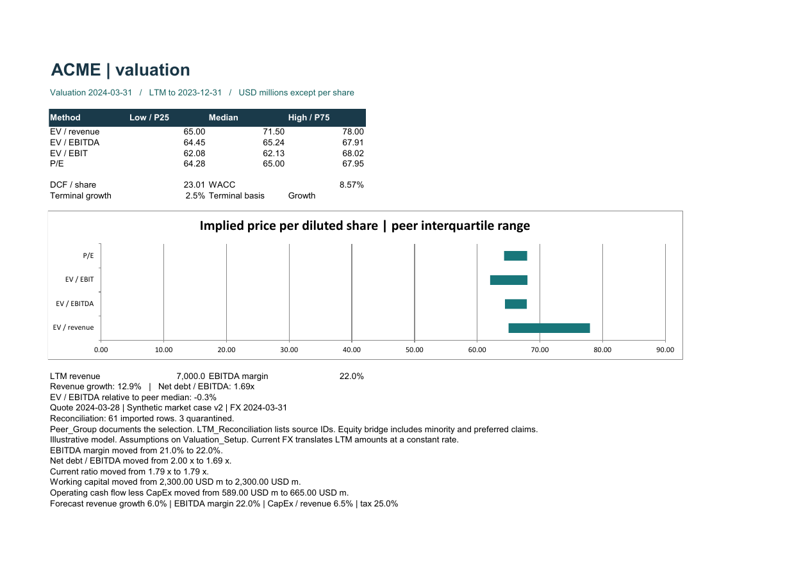
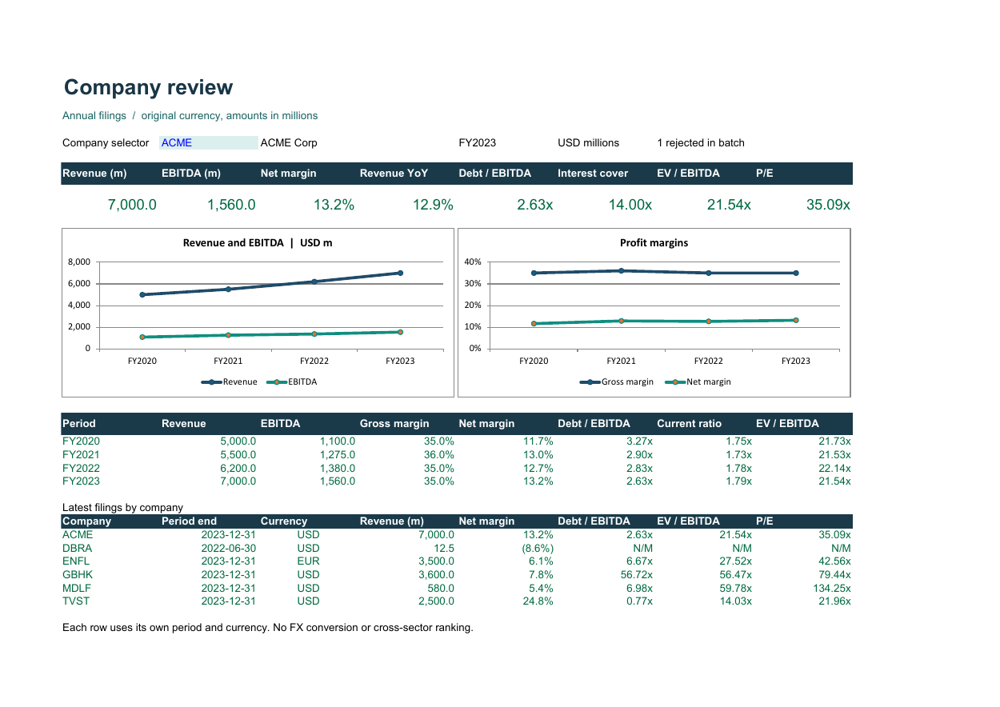

# FinAutomate

**Created by [Kartik Pawar](https://github.com/KartikPawar1411)**

**Investment Banking Excel Automation and Financial Reporting Suite**

FinAutomate turns financial extracts into annual company reports, calendar-aligned trading comparables and discounted cash flow valuations. Open the [Excel application](FinAutomate.xlsm) and follow **Home → Open valuation workspace**. The saved synthetic valuation covers four industrial issuers. The original annual dashboard covers six issuers.

[View the valuation PDF](reports/Valuation_Case.pdf) · [Run the platform](docs/VALUATION_PLATFORM.md) · [Tests, benchmarks and 54-second demo](docs/UPGRADE_REPORT.md)

## Try it in two minutes
1. Extract the **entire** project to a writable folder and open the workbook in Excel Desktop for Windows under your normal macro policy. Set up Python 3 on PATH to refresh dated valuation data and submit reviews. The saved workbook and original annual VBA workflow can be used independently.
2. Open **Dashboard** and change the company selector from **ACME** to **ENFL**. Revenue switches from USD 7,000m to EUR 3,500m. EnergyFlow's source was in thousands; its share price was not rescaled.
3. In **Clean_Data**, filter **Validation_Status** to **Rejected**. Trace the decision to the DataBridge source row. In **Financial_Ratios**, inspect a formula: ACME FY2023 EBIT / interest is 14.00x; TechVista's missing inventory makes its quick ratio unavailable.
4. On **Home**, choose **Company** or **Comparison** and click **Export PDF**. It refreshes the model and writes a new file in `reports/`. [Company review](reports/ACME_Annual_Review.pdf) · [Peer comparison](reports/Peer_Comparison.pdf)
5. To run your own batch, use **Import financial data**, then **Run full workflow**. Import appends. See the [operator guide](docs/USER_GUIDE.md) for an empty starting workbook.

## Annual reporting evidence
| Measured or verified item | Result for the included demo |
|---|---:|
| Source files / raw company-years | 6 / 21 |
| Accepted / rejected / exact duplicates | 20 / 1 / 0 |
| Formula outputs independently checked | 340 (20 filings × 17 ratios) |
| Native Excel PDF exports | 2 |
| Timed automation, Excel 16.0 build 20527 | 4.018 seconds, one local run |

The stopwatch covers demo loading through both PDF exports, excluding Excel startup. This is a small regression fixture, not a throughput guarantee. There is no measured manual baseline. [Machine-readable result](docs/benchmark.json) · [Reproduce the timing](docs/BENCHMARKING.md)

## Annual reporting workflow
`CSV / XLSX → Raw_Data → Clean_Data → Financial_Statements → Financial_Ratios → Dashboard / Company_Comparison → Report → PDF`

- **Traceability:** Raw_Data retains imported field values in the canonical schema, with a source filename, source record number and import timestamp. Source-supplied status fields never decide admission. Clean_Data records transformations, exclusions and conflicts.
- **Financial integrity:** Monetary amounts and shares convert to millions; currency and price per share stay in original units. Only annual consolidated actuals are in scope. No currency conversion, pooled revenue or indiscriminate peer ranking.
- **Restatement control:** Same company, year, sales and earnings do not prove two filings are identical. All 35 business fields are compared after normalization. Identical repeats are excluded; distinct versions of one issuer-year are quarantined for review.
- **Reproducibility:** Exported VBA, a workbook shell, Windows build scripts and independent regression checks for Excel's saved results accompany the release.

## Project map
| Path | Contents |
|---|---|
| [vba_modules/](vba_modules/) | Import, cleaning, validation, ratios, UI, reporting, export and logging |
| [templates/](templates/) · [sample_data/](sample_data/) | Input contract, six demo extracts and malformed fixtures |
| [scripts/](scripts/) | PowerShell Excel assembly and integration tests; independent ratio verifier |
| [docs/](docs/) | [Operator guide](docs/USER_GUIDE.md), [formula dictionary](docs/FORMULAS.md), [developer guide](docs/DEVELOPER_GUIDE.md), [QA](docs/QA_CHECKLIST.md), [troubleshooting](docs/TROUBLESHOOTING.md), [résumé and interview notes](docs/RESUME_DESCRIPTION.md) |
| [reports/](reports/) · [screenshots/](screenshots/) | Excel-generated PDFs and rendered workbook views |

The sample companies and financials are synthetic. The workbook provides financial analysis, not independent assurance or investment advice.
