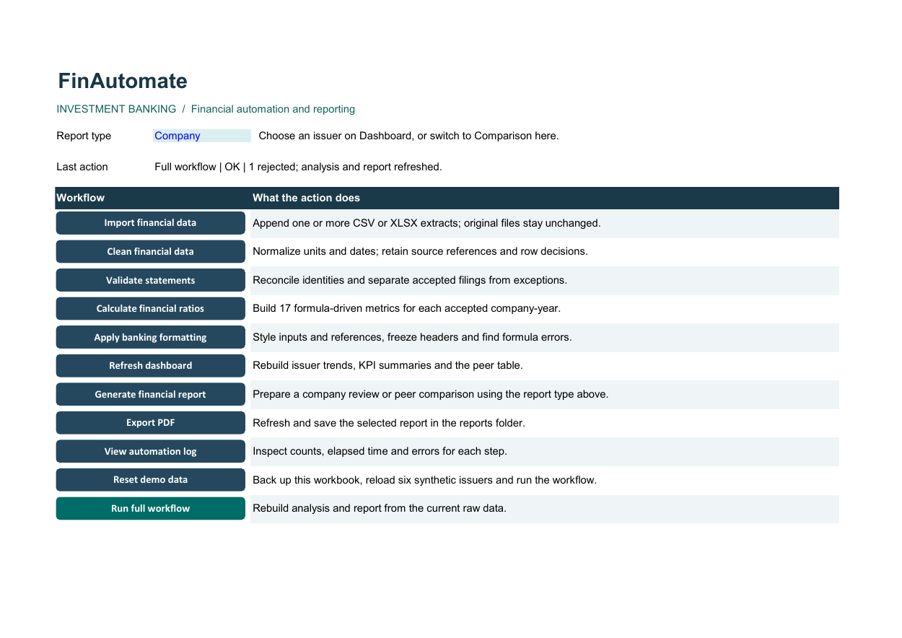
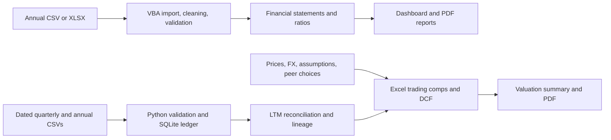

# FinAutomate

**Excel VBA financial analysis, valuation, and reporting platform** · Created by [Kartik Pawar](https://github.com/KartikPawar1411)

FinAutomate automates recurring investment-banking analysis in Excel Desktop for Windows. It combines an annual reporting workflow built with VBA and a linked dated-financials workflow for LTM analysis, trading comparables, and DCF valuation.

> **Demo data is synthetic.** The workbook does not connect to a live market-data service and does not provide audited analysis or investment recommendations.

## At a glance

| | |
|---|---|
| **Primary platform** | Microsoft Excel Desktop for Windows, VBA, native formulas and charts |
| **Supporting tools** | Python, SQLite, PowerShell, Excel COM |
| **Included examples** | Six synthetic annual issuers and a separate four-issuer valuation case |
| **Project files** | [Macro workbook](FinAutomate.xlsm) · [Workbook template](FinAutomate_Template.xlsx) · [Input template](templates/import_template.csv) |

## What it does

### Annual reporting in Excel/VBA

- Imports annual CSV and XLSX financial statements into a source ledger.
- Cleans and validates rows, records rejected or duplicate data, and calculates 17 financial ratios.
- Refreshes company trends, a comparison table, and company or peer-comparison PDF reports.
- Preserves source identifiers and processing outcomes in the workbook.

### Dated financials and valuation

- Processes quarterly, year-to-date, fiscal-year, and stub-period inputs with publication cutoffs and revision controls.
- Reconciles LTM periods, currency and scale inputs, source records, and review decisions.
- Builds peer statistics, implied equity values and share prices, a football-field view, and a five-year DCF with sensitivities.
- Keeps dated financials, assumptions, market prices, and FX inputs traceable to their source records.

The two workflows use separate input contracts. The annual workflow is ready to use from the saved workbook. Refreshing dated valuation inputs and submitting exception reviews require Python 3 and SQLite. See the [operator guide](docs/USER_GUIDE.md) and [valuation guide](docs/VALUATION_PLATFORM.md).

## Screenshots

<p align="center">
  
  
</p>

<p align="center">
  
</p>

Open the [valuation report](reports/Valuation_Case.pdf), [annual company report](reports/ACME_Annual_Review.pdf), or [peer comparison](reports/Peer_Comparison.pdf).

## Quick start

1. Clone or download the repository and extract it to a writable folder.

   ```powershell
   git clone https://github.com/KartikPawar1411/FinAutomate.git
   cd FinAutomate
   ```

2. Open `FinAutomate.xlsm` in Excel Desktop for Windows using your normal macro-security settings.
3. On **Dashboard**, change the company selector to inspect another synthetic issuer. For example, ACME reports USD 7,000 million of FY2023 revenue; ENFL reports EUR 3,500 million. The dashboard preserves each company's reporting currency.
4. On **Home**, choose **Company** or **Comparison**, then use **Export PDF** to refresh and export the selected annual report.
5. To try the valuation workflow, choose **Open valuation workspace** on **Home**. The saved case is ready to inspect. Python 3 on `PATH` is required to refresh dated valuation inputs or submit a review action.

For an import demo, use **Import financial data**, then **Run full workflow**. Start with the supplied [input template](templates/import_template.csv); review the [user guide](docs/USER_GUIDE.md) before importing a custom dataset.

## Architecture



### Repository map

| Path | Purpose |
|---|---|
| [vba_modules/](vba_modules/) | Import, cleaning, validation, ratio calculations, dashboard, reporting, and logging |
| [scripts/](scripts/) | Workbook assembly, Excel COM workflows, independent checks, data preparation, and benchmarks |
| [sample_data/](sample_data/) · [templates/](templates/) | Synthetic annual extracts, edge cases, and the annual import template |
| [valuation/](valuation/) | Dated synthetic financials, market and FX inputs, review history, and lineage tables |
| [reports/](reports/) · [screenshots/](screenshots/) | Example PDF outputs and rendered workbook views |
| [docs/](docs/) | User and developer guides, formulas, QA checklist, benchmarks, and resume notes |

## Verification and measured performance

- **340/340** saved annual ratio outputs matched independent calculations.
- **30/30** dated financial-engine checks passed.
- **17/17** native Excel valuation assertions passed in Excel Desktop.
- A measured annual demo run took **4.018 seconds** from demo loading through two PDF exports, excluding Excel startup. No manual baseline was measured.

One native Excel scale run measured refresh times of **0.889 seconds** for 1,000 records, **1.428 seconds** for 10,000, and **5.324 seconds** for 50,000. These are individual local runs, not service-level guarantees. Hardware, stage timings, memory, output sizes, and reproduction steps are in the [benchmark report](docs/BENCHMARKING.md). Test expectations and results are in the [upgrade report](docs/UPGRADE_REPORT.md).

Run the available checks from PowerShell:

```powershell
python scripts/test_workbook.py
python scripts/test_valuation.py
.\scripts\test_excel.ps1
.\scripts\test_valuation_excel.ps1
```

The Python checks do not require Excel. The PowerShell integration checks require Excel Desktop for Windows. Native Excel runs used Windows 11, Excel 16.0 build 20527, and Python 3.15.2. To assemble the macro workbook from source, see the [developer guide](docs/DEVELOPER_GUIDE.md); the build uses Excel COM and requires VBA project access.

## Financial basis and limitations

- All included company financials, prices, and FX observations are synthetic.
- Annual statements remain in each issuer's reporting currency; the annual workflow does not translate or pool currencies.
- Dated valuations use supplied inputs. Analysts remain responsible for verifying sources, reporting basis, peer selection, and assumptions.
- Missing inputs and nonmeaningful denominators remain unavailable rather than being presented as zero.
- The DCF uses configurable operating drivers and terminal assumptions; it does not model a debt schedule, tax-loss carryforwards, or changing capital structure.
- Outputs are analytical examples and are not independently audited or investment recommendations.

See the [formula dictionary](docs/FORMULAS.md), [QA checklist](docs/QA_CHECKLIST.md), [troubleshooting guide](docs/TROUBLESHOOTING.md), and [resume/interview notes](docs/RESUME_DESCRIPTION.md) for more detail.
