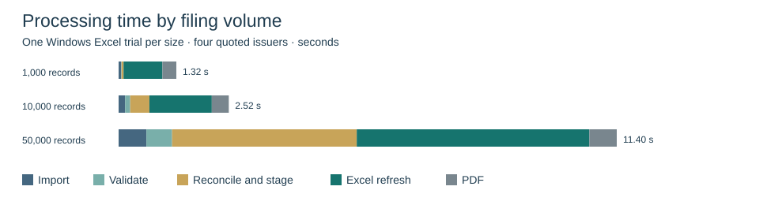

# Valuation platform release

The existing annual reporting workbook was extended with a dated financial record ledger, LTM reconciliation, a trading-comps model and a five-year DCF. In the synthetic case, the median EV/EBITDA peer multiple implies **$65.24 per diluted share**. The five-year DCF gives **$23.01** at an **8.56875% WACC**. The difference reflects the valuation inputs and methods. The workbook exposes the operating assumptions, terminal value and peer set for review.

## Changed components

| Component | Location and purpose |
|---|---|
| Excel application | FinAutomate.xlsm retains the original eleven sheets and controls and adds the valuation workspace, financial history, review, lineage and control sheets. |
| Annual VBA | modImport, modUtilities, modMain, modCleaning and modDashboard carry hash, batch and source identifiers through the annual workflow and link to valuation. |
| Valuation VBA | modValuation loads the ledger projections and records peer selections. modTradingComps builds peer statistics, target prices, chart and print view. modDCF builds editable formulas and sensitivities. modProvenance fingerprints annual sources and filters target lineage. |
| Dated financial engine | scripts/periods.py handles normalization, publication cutoff, revisions, review and LTM. scripts/valuation_data.py joins market and FX inputs and stages the Excel tables. |
| Fixtures | scripts/valuation_fixture.py produces the reproducible synthetic filings, market prices, FX observations and conflicting-record cases in valuation/. |
| Build and verification | scripts/assemble_workbook.ps1 assembles the expanded workbook. The original annual tests remain. New financial and Excel assertions, stress-data generators and native benchmarks live in scripts/. |
| Portfolio assets | reports/Valuation_Case.pdf, screenshots/Valuation_Case.png, the performance comparison and the demonstration script document the saved application. |

## Tests and actual results

| Executed suite | Expected | Observed |
|---|---|---|
| Annual baseline, before upgrade | Existing saved ratios and native annual workflow pass | All 340 saved Excel results matched. Excel import, duplicate, conflict, selector, PDF and error-path checks passed. |
| Annual regression on expanded workbook | Original reporting workflow and 17 metrics remain functional | Native regression passed on the expanded workbook. Final packaged workbook independently reconciled 340 results and had zero cached cell errors. |
| Point-in-time regression | All financial data, reconciliation, review and lineage cases pass | 30/30 passed, including gap/overlap, fiscal transition, late publication, EV bridge and approval failure. |
| Native valuation | Independent DCF, peer valuation, sensitivities and file-safety checks agree with Excel | 17/17 passed. WACC 8.56875%, DCF EV 14,189.093588m, DCF price 23.008187, median P/E 35.714286x, implied equity 32,500m. |
| PDF | Legible company valuation print view | Single A4 landscape page with football field, DCF, operating commentary and basis. |

Expected and actual values for every new assertion are in [financial-engine results](valuation_tests.json) and [native Excel results](valuation_excel_tests.json). Annual test procedures are documented in [QA](QA_CHECKLIST.md). Native execution used Excel Desktop 16.0 build 20527.

## Scale benchmark

| Imported | Accepted | Quarantined | Import I/O + SQLite (s) | Normalize + validate (s) | Reconcile, LTM + staging (s) | Excel refresh (s) | PDF (s) | Peak Python / Excel (MiB) | Saved workbook (bytes) |
|---:|---:|---:|---:|---:|---:|---:|---:|---:|---:|
| 1,000 | 987 | 13 | 0.056 | 0.012 | 0.045 | 0.889 | 0.319 | 28.5 / 213.9 | 392,224 |
| 10,000 | 9,897 | 103 | 0.149 | 0.116 | 0.439 | 1.428 | 0.389 | 77.8 / 231.6 | 1,455,191 |
| 50,000 | 49,497 | 503 | 0.636 | 0.588 | 4.225 | 5.324 | 0.626 | 295.2 / 348.6 | 6,146,864 |



Each trial used a disposable workbook, a new financial database and a new Excel process. Each dataset includes the 61-row case and synthetic quarterly filings up to the stated total. Every hundredth additional row has invalid revenue. Four issuers have quotes and the target has three peers. The Excel refresh includes loading the lineage sheet and rebuilding valuation views. Timings exclude startup, fixture generation and workbook saving. PDF timing covers one valuation summary. Peak working sets are process-level readings and may peak at different moments. Normalization and validation share one pass. One observation was recorded per size. No manual baseline was measured.

Environment: Windows 11 x64 build 26300, Intel Family 6 Model 183, 24 logical processors, Python 3.15.2 and Excel build 20527. The [full native measurements](scale_excel.json) and [standalone engine measurements](scale.json) describe distinct workloads.

## Reproduce

From the extracted project folder in PowerShell:

```powershell
python scripts/test_workbook.py
python scripts/test_valuation.py
./scripts/test_excel.ps1
./scripts/test_valuation_excel.ps1
./scripts/benchmark_excel.ps1
```

The valuation Excel test regenerates the example PDF. The benchmark regenerates the native timing JSON. Close the workbook before rebuilding. The shipped staged case tables allow the Windows build to use the existing template. To rebuild from changed financial fixtures, run `python scripts/valuation_data.py` first, then `./scripts/assemble_workbook.ps1`. The Excel build needs an existing profile that permits VBA project automation. Read the [operator and modeling guide](VALUATION_PLATFORM.md) for the full input contract, review actions and remaining limits.

## 54-second recording storyboard

Use an extracted disposable copy. Set ACME as target and keep the prepared review-case record ID in the clipboard.

| Time | On screen | Voiceover |
|---|---|---|
| 0–6s | Home → Import financial data → choose an annual CSV | “This control loads an extract and records its source hash and batch.” |
| 6–12s | Validate statements → Clean_Data, show status and source record | “Each financial row has a disposition. Accepted rows feed the annual analysis.” |
| 12–20s | Valuation_Setup → SubmitReview for a reviewed REVIEWCASE ID → Review_History | “For dated filings, conflicting versions stay quarantined until a reviewed source passes validation.” |
| 20–25s | Select ARCO and refresh | “I’m valuing a June year-end issuer at the same cutoff as its peers.” |
| 25–31s | LTM_Reconciliation → ARCO | “Its December LTM uses the fiscal year, plus current YTD, less prior comparable YTD.” |
| 31–37s | Peer_Group → change Include and give the reason | “The peer universe is explicit. The target is excluded from each distribution.” |
| 37–43s | RefreshValuation → summary and DCF | “Each multiple gives a price range. The DCF adds an independent forecast and WACC sensitivity.” |
| 43–49s | TraceValuation → filtered Record_Lineage | “These are the original records and transformations behind the target's LTM.” |
| 49–54s | ExportValuationPDF → open the PDF | “The report captures the valuation date, assumptions, exceptions and result.” |

A timed storyboard is supplied. The optional Windows capture helper was written but could not be exercised because automatic approval review hit its usage limit before desktop capture ran.
