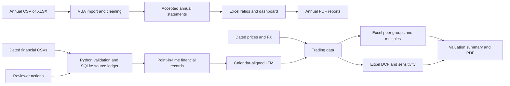
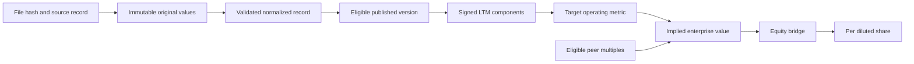

# Running the valuation workspace

Extract the whole release into a writable folder. Open FinAutomate.xlsm in Windows Excel Desktop under the normal macro policy. The saved case, charts and formulas are ready to inspect. Refreshing the dated valuation inputs and submitting a review require Python 3 with SQLite available as `python` on the Windows PATH. The release was tested with Python 3.15.2. The annual workflow runs in Excel/VBA.

1. From Home choose **Open valuation workspace**. The two dates are the information cutoff and the common financial period end. The period must end on or before the cutoff.
2. Pick an eligible target in B5. Set the reporting currency and forecast, capital structure and terminal assumptions in the blue cells. The shipped case uses March 31, 2024, December 31, 2023, USD and ACME.
3. In **Peer_Group**, edit Include and Selection reason. Use the industry, geography, business-model columns and financials in Trading_Data to make the selection. On **Valuation_Setup**, B20 selects or names the group. Changes to an existing group are recorded on refresh. Save the workbook to retain peer decisions.
4. Click **RefreshValuation** after changing the target, dates, currency or peer group. Check Trading_Comps, DCF, and Valuation_Summary. The target is excluded from peer statistics. A newly named group starts with peers excluded.
5. Click **TraceValuation** to filter Record_Lineage to the selected target's current LTM records. For a peer statistic, inspect its eligible Peer_Group formulas, then the issuer rows in Trading_Data and the signed record IDs in LTM_Reconciliation.
6. Click **ExportValuationPDF** to refresh and write the current summary to reports. The original Home export continues to generate annual company and peer reports.

## Inputs and source control

The original annual importer accepts its existing CSV/XLSX contract. It now carries source SHA-256, a record ID, batch GUID and worksheet through to accepted statements. For the separate point-in-time valuation workflow, copy CSVs following the columns in **valuation/filings/periods.csv** into **valuation/filings/**. Supply consolidated flow metrics for the stated interval and end-period balance and share counts. Kinds are Q, FY, YTD and STUB. Give each record inclusive start/end dates, publication date, currency, scale and an identifiable source. Prices belong in valuation/market.csv and direct currency rates in valuation/fx.csv. All three CSV formats are demonstrated by the shipped fixture. A preparer must verify external figures and the source's reporting basis before use.

Use the same issuer ID across all three inputs. Financials are normalized to millions, including diluted shares. Supply explicit zeros for economically absent EV bridge components. Supply a direct rate expressed as **reporting currency per unit of filing currency**. Market quotes are per share in filing currency. Each issuer/date combination should have one unambiguous quote and each currency pair/date one rate. The demo files are synthetic. The annual ACME case and the separate quarterly ACME valuation case have different constructed earnings inputs. Use each with its own documented basis.

On refresh, Python stores original rows and source hashes in valuation/valuation.sqlite. Identical file bytes are idempotent. A dated revision is submitted as a new file. The database retains previous imports even if a source file is moved. To start an independent portfolio, use a new project copy with an empty valuation/filings directory and a fresh database. Keep the original folder as the archive. Back up the workbook, database and input files together.

## Review a conflict

On a disposable project copy, filter Record_Lineage to REVIEWCASE. Its two valid versions were published on the same date with different sales. Both are quarantined. Copy the complete chosen record ID from column A into Valuation_Setup B22, enter Review, reviewer and note in B23:B25 and click SubmitReview. Check Review_History. Change the action to Approve, identify the approved source in the note and submit again. The next projection includes the validated chosen version and labels its competing version Superseded. An invalid numeric record cannot pass approval. Reject is available after Review. Original values and previous actions remain available.

Accepted, Quarantined, Rejected, Duplicate, Superseded and Deferred are disjoint current dispositions. Review is an action in the history. Quality_Control ties normalized revenue back to original revenue by source, period type, currency and unit for successfully normalized rows. These are ingestion control totals across records. Aggregating an FY and its quarters as economic revenue would double-count them. Record_Lineage lists missing fields and row-level failure details.

## Architecture and financial data flow

## Modeling decisions

- **Fiscal alignment.** Use a common twelve-month window ending on the selected date. Prefer four contiguous three-month quarters. An exact matching fiscal year is also eligible. Otherwise use the latest compatible FY + current YTD − prior comparable YTD with exact period boundaries. STUB inputs can fill the YTD roles when they have comparable dates. Signed record IDs disclose the components. End-period debt, cash and shares come from the closing statement. Flow measures are combined only when every component is present in the same currency.
- **Information cutoff.** Financials must have been published by the valuation date. The most recent eligible publication wins among revisions of one period. Market prices and FX use the latest eligible observation date. The same spot FX translates historical flows and balances for a constant-currency comparison. FX translation is a presentation convention. It differs from period-average income-statement translation.
- **Trading valuation.** Price × diluted shares gives diluted equity capitalization. Add debt, minority interest, preferred stock and other signed EV adjustments and subtract cash. For each eligible multiple compute count, minimum, inclusive quartiles, median, maximum and arithmetic mean. Apply EV multiples to the target operating metric and subtract the target bridge to obtain equity. Apply P/E to positive target earnings, then add the bridge to obtain EV. Divide equity value by positive diluted shares. The football field displays P25 through P75 implied prices. Missing bridge inputs or an invalid denominator suppress affected outputs.
- **DCF.** The reported LTM is the revenue base. Each projected year applies editable growth, EBITDA margin, D&A and CapEx ratios. NWC investment equals incremental revenue × incremental NWC intensity. Cash tax applies to positive EBIT. UFCF equals EBIT less cash tax plus D&A less CapEx less NWC investment. Equity cost equals risk-free rate plus levered beta × equity risk premium. WACC uses target debt weight and after-tax debt cost. The model discounts five annual cash flows and terminal value at year end. Growth terminal value requires WACC above growth and positive terminal cash flow. The alternative uses positive terminal EBITDA × exit multiple. The 5×5 table varies WACC and perpetual growth. It remains a growth-method sensitivity when the primary model uses an exit multiple.
- **Commentary.** Observations uses current and prior LTM revenue, margin, leverage, liquidity, working capital and cash flow. The summary also calculates the EV/EBITDA premium or discount. Annual interest coverage remains available in the original dashboard. Each numeric statement can be checked against Valuation_History, Trading_Data or the peer formulas.

## Scope and limitations

Annual reporting and dated valuation inputs have separate ingestion contracts. Annual extracts lack filing publication dates and cannot establish historical availability on their own. The release has no live market-data feed or automatic verification of vendor source claims. Analysts supply dated quotes, bridge items, FX and peer judgments. The demo uses three peers. A small eligible set makes quartiles sensitive to individual companies.

Calendarization supports matching observed windows and comparable stubs. A fiscal-year change that breaks comparability, an irregular 52/53-week period, or an incomplete series can leave LTM unavailable. The engine does not estimate missing quarterly data by interpolation or difference cumulative-only statements into standalone quarters. DCF assumes five equal annual forecast intervals from the valuation date, a constant set of operating drivers and year-end discounting. It does not model a partial forecast year, tax-loss carryforwards, debt schedules or changing capital structure.

The review ledger provides logical append-only history in the valuation workflow. Annual exceptions retain the original annual resolution procedure. Reviewer identity is entered by the operator. Current review decisions are applied to the chosen historical cutoff, so this is a retrospective analysis rather than a replay of what a reviewer had approved on that past day. Market and FX inputs retain date and source attribution, but lack the immutable revision history used for statement files. The trace button follows the target's current LTM. Tracing a peer quartile or prior LTM requires following the contributing rows. Saving the Excel workbook persists assumptions and peer choices. If a refresh fails, correct the displayed error and rerun it before using the outputs.

Reference for underlying finance definitions: [NYU Stern financial measures and ratios](https://pages.stern.nyu.edu/~adamodar/New_Home_Page/definitions.html).
